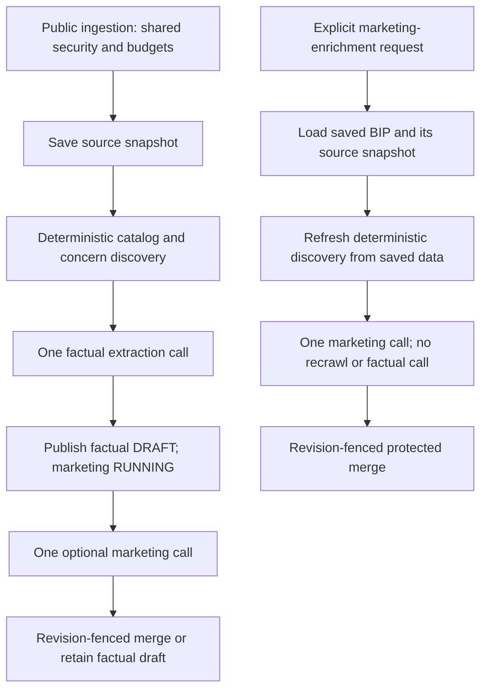

# Phase 1C P0: discovery and independent marketing enrichment

Phase 1C keeps PostgreSQL, the existing worker/queue, draft-first onboarding, the twelve BIP
roots, optional strict extraction, account/model binding and billing restrictions. It adds
no primary model call to onboarding and no frontend or campaign/deep-analysis implementation.

## Pipeline and persistence



Discovery is persisted before factual inference. Brand/catalog/concern reads can therefore
show observations even before a BIP exists. In draft-first mode, the validated factual draft
is published before the initial marketing request finishes. Each published profile change
advances the revision: a normal initial extraction can publish a factual checkpoint and a
later enrichment result. Final writes are fenced against edits made after the checkpoint.
Strict mode retains its existing evidence pipeline and save behavior.

Migration **0004** adds:

- `catalog_products`: stable UUID and unique `(brand_id, product_key)`, latest observation
  JSONB, source-extraction FK, optional FK to the matching BIP offering.
- `customer_concerns`: stable UUID and unique normalized concern key per brand, source FK,
  source-derived label/description, related catalog IDs/offering keys and discovery metadata.
- Job `kind` (`EXTRACTION` or `MARKETING`), `source_job_id`, `replace_reviewed`, diagnostics;
  terminal marketing status `INSUFFICIENT_DATA`.
- Nullable `profiles.source_job_id`, explicitly assigned to new factual snapshots.

Catalog records are not inserted into `BIP.offerings`. Product URL/name matches establish
links to existing offerings; categories remain lightweight source attributes. Existing
BIP family/product/variant keys and relational offering IDs are preserved. Catalog and
concern links are refreshed after customer edits, including corrected names or keys. Stable catalog
UUIDs and the detail endpoint let future flows select a product without another full-brand
extraction. No later detailed-analysis flow is implemented here.

Older profiles are not rewritten by migration. When needed, legacy snapshot binding uses
the successful extraction whose completion matches the profile's original extraction time;
failed/newer crawls are excluded, and missing or ambiguous association is an error. No
historical source evidence is invented. Original extraction timestamps and provider/model
metadata stay intact after independent marketing; its own model/metrics are on the job.

## Deterministic discovery

Products come from Product/ProductGroup/Course/Service JSON-LD, public Shopify-style product
responses when detected, product links/cards, category pages and product HTML metadata.
JSON-LD names, URLs, images, identifiers and offers are retained in saved structured metadata.
Product-group variant relationships, canonical product URLs and explicit identifiers avoid
counting the same size/variant repeatedly. Supporting tool/blog/app/pricing links are excluded.
Missing attributes remain null; there is no model-generated inventory, price or image.

Optional `/products.json` pagination uses the existing DNS-pinned public fetcher, same-origin
redirect policy, robots checks, response-size limits, elapsed deadline and shared request/page
budgets. Only bounded `page`/`limit` parameters on public product endpoints are retained.
`CATALOG_MAX_PAGES=3` and `CATALOG_MAX_PRODUCTS=1000` are additional ceilings, not targets.
Unsupported/blocked public endpoints produce limitations/warnings and HTML discovery continues.

Prices are strings containing explicitly observed nonnegative values. Currency is null
unless stated; compare-at prices and availability are not inferred. The price/availability
basis is the first explicitly listed offer/variant, not a claim of global inventory or an
aggregate lowest price. `price_observed_at`/`observed_at` identify source fetch time;
`discovered_at` records first deterministic discovery time. Saved-snapshot backfills do not
pretend discovery happened historically and never overwrite newer observations with older
ones. Partial crawls do not delete previously observed products or concerns.

Concern discovery uses a small, transparent problem/need phrase matcher across page text,
headings/navigation, product context and FAQ text. Display labels and short descriptions
come from actual matching source text. A product category alone does not generate a concern.
Rules are intentionally limited; they are not a universal semantic segment classifier.
No demographics or audience percentages are assigned. Concern records are marked
`WEBSITE_DERIVED_CONCERN_NOT_MEASURED_BEHAVIOR`, never mixed into measured customer data or
silently promoted to buyer psychology. They remain available when marketing fails.

## APIs

All routes retain existing bearer-token authorization. No live job is triggered by GETs.

| Endpoint | Purpose |
| --- | --- |
| `POST /v1/brands/{brand_id}/marketing-enrichments` | Queue one marketing-only attempt |
| `GET /v1/marketing-enrichments/{job_id}` | Status, bound model/account, snapshot, diagnostics and usage |
| `GET /v1/brands/{brand_id}/catalog?limit=20&offset=0` | Paginated observed products and coverage |
| `GET /v1/brands/{brand_id}/catalog?category=Skin%20Care&linked_only=true` | Category/analysis-link filters |
| `GET /v1/brands/{brand_id}/catalog/{product_id}` | Select/read a stable catalog product |
| `GET /v1/brands/{brand_id}/customer-concerns` | Website-derived potential concerns |

Brand GET adds `catalog` and `customer_concerns`; profile GET/PATCH/confirm also add
`source_job_id` and `marketing_enrichment`. Existing offering/profile endpoints and BIP
structure remain. Catalog pagination accepts limits 1–100 and nonnegative offsets.
Counts distinguish all known observations, filtered records and links to BIP offerings.
Coverage describes the latest discovery attempt, including its saved-snapshot association
where applicable; it is not a promise that all products were found.

Marketing request fields:

```json
{
  "expected_revision": 4,
  "offering_key": "your-existing-offering-key",
  "replace_reviewed": false,
  "chatgpt_account_id": "optional-authorized-account-uuid",
  "marketing_model": "optional-account-available-model-id"
}
```

All are optional; omitted revision is captured transactionally at enqueue time. Supply the
current profile revision to reject a stale client immediately. Account/model defaults come
from the existing authorized selection. `replace_reviewed` must be a JSON boolean. A usable
offering and saved source snapshot are required; unknown/incomplete selections are rejected.

Example only—execute after separately authorizing a live enrichment:

```bash
curl -X POST "http://127.0.0.1:8000/v1/brands/$BRAND_ID/marketing-enrichments" \
  -H "Authorization: Bearer $API_ACCESS_TOKEN" \
  -H 'Content-Type: application/json' \
  -d '{}'
# Poll the returned Location/poll_url; do not resubmit to poll.
```

Catalog items contain `id`, `name`, nullable `url`/`image_url`, `categories`, `brand`, `sku`,
`external_id`, observed `price`/`currency`/`compare_at_price`, `availability`, `variants`,
`source_urls`, discovery/observation timestamps, `source_job_id`, and nullable
`linked_offering_id`/`linked_offering_key`. The paginated envelope includes `total`,
`total_discovered_products`, `linked_to_offerings`, `available_categories`, `limit`, `offset`
and coverage/limitations. Categories and analysis links are distinct from customer concerns.

Concern items contain `id`, `name`, optional `description`, `source_urls`,
`catalog_product_ids`, `offering_keys`, `discovery_methods`, discovery/observation timestamps
and the explicit interpretation marker. Related IDs/keys are populated only when matched.

Marketing jobs use `PENDING`, `RUNNING`, `SUCCEEDED`, `FAILED`, or `INSUFFICIENT_DATA`.
Diagnostics report generated insight leaves, merged leaves and protected merge paths;
arrays are atomic merge fields. Empty or protected-only results are insufficient, never a
fully successful enrichment. `poll_url` identifies the marketing job; the generic extraction
job lookup remains compatible with the shared underlying job table.

## Enrichment safety and latency diagnostics

Marketing-only execution loads the current BIP and the specific saved source snapshot;
it does not call the crawler or factual provider method. Deterministic discovery can be
backfilled from that saved snapshot without network access. It uses compact offering briefs,
bounded relevant passages and up to 20 concern signals. Factual calls get category/count
summaries (up to 50 categories), not a complete catalog JSON dump.

Only audience/psychology, eligible voice interpretations and creative fields can merge.
Company identity, product details, ingredients, prices, claims and observed assets cannot be
changed by marketing. Factual provenance remains intact; new hypotheses are `INFERRED` with
no mandatory citations. USER/confirmed values and explicit clears are protected by default.
Arrays with protected content are kept atomically. `replace_reviewed=true` can replace
reviewed marketing hypotheses, but still cannot overwrite factual observations. Historical
strict marketing audits/provenance are archived before replacing their interpretation.
Customer review/claim-approval restrictions remain unchanged.

A brand's existing unique active-job constraint prevents simultaneous extraction/enrichment.
A repeated same-kind trigger reuses its active job; a competing different kind returns 409.
The revision and lease are checked again at commit. A stale result is discarded; failures,
empty results and protected-only results leave the persisted profile unchanged. Latest-job
read views still expose progress/failure. Successful changes become a new DRAFT revision.

Exactly one marketing provider invocation is made for a valid attempt. Auth/input/schema
preflight failures may make zero inference requests. No automatic inference retry or billing
fallback occurs. Expired marketing leases become terminal failures rather than reissuing a
potentially paid request, even with larger general job retry settings. Models/reasoning,
OAuth binding and the configured 60-second marketing deadline are preserved.

ChatGPT usage records now include safe streaming metrics:

- `time_to_first_event_seconds`: elapsed transport time to the first SSE data event,
  including a reasoning event without storing its contents.
- `time_to_first_output_text_seconds`: elapsed transport time to first nonempty output text.
- `total_stage_seconds`/`latency_seconds`: inference transport plus structured parsing time.
- `stream_outcome`: `COMPLETED`, `TIMEOUT`, `DISCONNECTED`, `INCOMPLETE` or `FAILED`;
  input/output tokens when reported. Missing event/token times remain null.

No private reasoning, credentials or raw model responses are logged or persisted. Model
catalog/OAuth preflight occurs before the inference transport timer; job timestamps also
capture the full operation. A completed stream can still fail structured validation, so
transport outcome and successful merge remain distinct. Timeout usage can be unknown.

## Validation, rollout and remaining unknowns

Offline tests cover saved Minimalist/Whole Truth/Fastlane/Newton data, constructed public
catalog/HTML responses, variants and deduplication, unsafe URLs, missing prices, robots and
budgets, PostgreSQL/API persistence, model/account binding, exactly one mocked marketing
request, edits/confirmation, stale revisions, failures/empty responses and interrupted
streams. Migration 0004 downgrade/re-upgrade preserves legacy profile data/audits. Rollback
removes the new discovery tables/columns and maps new terminal `INSUFFICIENT_DATA` jobs to
`FAILED` for the old schema; back up new discovery data before any production rollback.

**Measured offline:** the saved pre-Phase-1C Minimalist snapshot contains seven distinct
structured products and website concern signals. A constructed public-response fixture
with 12 products yields 12 catalog records without any LLM call. Neither is a live count
of Minimalist's complete catalog, and no count of 83 is assumed. Historical snapshots
omitted some image/link metadata; absent fields cannot be reconstructed as facts.

**Expected, not measured live:** deterministic discovery can broaden visible inventory and
make concerns available before inference. Marketing-only retries requested by users avoid
an entire crawl and factual call; standard onboarding still has at most two primary model
calls. Extra public-data requests share the existing crawl budgets and may consume time
otherwise spent on HTML pages. Compact briefs/outputs may reduce marketing latency, but
no speedup or guaranteed completion within 60 seconds is claimed.

Live public endpoint availability/robots behavior, full catalog coverage, image/variant
quality, marketing usefulness and real stream timing remain unverified. Limited concern
rules can miss or overgroup needs. No live inference, live crawl or real extraction/enrichment
job was run for this implementation. Apply migration 0004 and rebuild/restart services before
any separately authorized live check; the running local deployment was not migrated/restarted
by this task, and existing production profiles were not modified.
