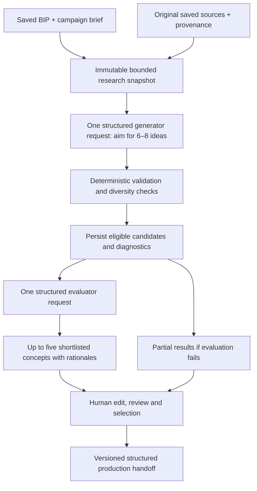

# Phase 2A: creative strategy and ideation

Phase 2A turns a saved BIP and an explicit campaign brief into reviewable short-form ad
concepts. It never edits the BIP, recrawls a website, fetches a reference URL or repeats
brand extraction. Rendering, competitor/social ingestion and publishing remain out of scope.
The feature uses the existing protected single-workspace installation, not multi-tenant SaaS.

## Data flow and persistence

Migration **0005** adds four PostgreSQL tables:

- `campaigns`: owning brand, editable JSONB brief and revision.
- `research_snapshots`: immutable context, campaign/BIP revisions and original extraction
  snapshot ID. A source cannot be deleted while a research snapshot references it.
- `creative_jobs`: durable lease, account/model binding, stage outcomes, safe error codes,
  validation diagnostics and usage. A partial unique index allows one active job per campaign.
- `creative_concepts`: candidate content, original content, hook variants, story, production
  requirements, deterministic flags, evaluation, revision and selection/review state.
  Nested fields use JSONB; IDs, ownership, revisions and lifecycle are relational.

Generations append new rows. They never replace earlier concepts, user edits or a selected
concept. Scores and shortlist membership are invalidated when a user edits a concept.
The original generator content remains available. Selecting a different concept explicitly
clears the previous selection and increments its revision; generation never does so.

Every research snapshot preserves the brief actually used. Editing a brief increments the
campaign revision. BIP and campaign revisions fence the generator checkpoint and evaluator
publication; stale work cannot overwrite current results. Historical candidates remain
inspectable. A selected concept based on an outdated brief/BIP cannot be handed off.

## Brief and creative contracts

Objective and either audience or concern are required. Geography, language, platform, CTA,
destination and references are nullable/optional; no geography or objective is invented.
Destination tracking parameters and landing-page fragments are preserved; URLs are never fetched.
`BRAND` scope has no selected offering key. `FAMILY` requires a saved family key; `PRODUCT`
requires a saved non-family offering key. Families include their children in research.
The first supported aspect ratio is `9:16`; the explicit default duration is 15 seconds,
configurable from 5–60 seconds. The suggested initial range remains about 10–20 seconds.

Each candidate contains a central insight and storytelling mechanism; one primary driver
(`RECOGNITION`, `CURIOSITY`, `DESIRE`, `RELEVANCE`); audience situation and tension; a
source-bound capability; one main and 2–3 alternative hooks; opening, development, product
connection and payoff; B-roll, asset/demo requirements, closing and CTA; research references,
factual assumptions and risks. Production format is `TEXT_OVER_VIDEO`.

The product capability must copy a capability-bearing research item literally. This is a
conservative trade-off: it makes the benefit connection traceable without another factual
inference call. Hooks and storytelling can interpret that capability but cannot substantiate
additional claims. A copied provisional BIP value remains provisional, not verified proof. Values longer than
the concept capability limit remain research context but are not offered as literal capability
references; no usable capability means a pre-inference research error.

The evaluator must assess every accepted candidate exactly once, return seven bounded
0–10 creative judgments, concise strengths/weaknesses and a rationale, and select at most
five. It cannot resurrect rejected candidates or introduce new IDs. Fewer selected concepts
are allowed and report `insufficient=true`; no selection is `INSUFFICIENT_DATA`. Scores are
**internal creative judgments, not forecasts of CTR, conversions or profit**.

## Research and evidence boundaries

The context builder reads existing offerings, source documents and provenance. It balances
positioning, voice, audiences, benefits, customer psychology, reviews, visual identity and
creative themes, reserving room for bounded source passages. Marketing restrictions and
user brief/reference text are reserved before optional items; oversized mandatory context
fails before inference rather than silently dropping restrictions. Source metadata retains
URLs, fetch timestamps and content hashes. Research IDs are path-derived and scoped to
one immutable snapshot; they are not globally reusable citations.

Origins are preserved. A `WEBSITE` observation is labeled source-verified only when the
original cited quote and value occur in the saved source. `AI_EXTRACTED`/unknown values
stay provisional; user assertions and `INFERRED` hypotheses stay distinct. Source matching
is not independent clinical verification. Customer quotes are opinions, with published
attribution only. A conservative keyword signal marks negative/mixed feedback; all other
quotes remain sentiment-unassessed. Neither becomes an approved positive endorsement.

The generator receives untrusted research/reference text as data. The evaluator receives a
compact subset containing all referenced items plus brand/voice/visual guidance and mandatory
restrictions, not another full crawl. No URL in a reference or destination is fetched.

## Validation and review

Checks reject schema violations, unknown IDs, unsupported capability connections, mismatched
audience/CTA, explicit excluded phrases and avoided terms, normalized duplicate hooks,
identical insights and sufficiently similar same-mechanism structures, unsupported production
assumptions and model assertions that assets are already available. `requires_creation=true`
is required for suggested assets because Phase 2A has no asset ownership/upload attestation.

Uncertain numerical, sensitive, testimonial, provisional-fact, asset and duration claims
remain flagged for review. Obvious blanket cure/safety guarantees are blocked. Full brand
rules are supplied to both passes and remain visible; natural-language restrictions and
semantic paraphrases are not completely enforceable through lexical checks. Sentiment,
audience compatibility, distinctiveness and feasibility checks are deliberately conservative,
not complete semantic verification. A human must review the actual concepts.

`select` reserves a concept for future production. `approve` additionally requires explicit
human-review, claim-risk and asset-requirement acknowledgments. Both require current research
and no blocking flags. Approval is **production review only**, never automatic advertising,
legal or clinical approval; the handoff keeps `advertising_claims_approved=false` and the
original risks. There is no video rendering or publishing endpoint.

## Jobs, cost and failure behavior

The existing worker alternates the creative and brand queues. Each creative job receives
one lease with a maximum of **two inference calls**, one per pass. The adapter reuses the
configured provider and enqueued account/model, forces a single transport attempt and never
falls back to a different model or billing source. ChatGPT-plan access/preview restrictions
and API-key opt-in remain unchanged. DeepSeek remains blocked by the runtime factory.

Defaults:

| Setting | Default |
|---|---:|
| `CREATIVE_CONTEXT_MAX_CHARS` | 30,000 serialized research characters |
| `CREATIVE_MAX_INPUT_TOKENS` | 20,000 estimated tokens per request, including schema |
| `CREATIVE_GENERATOR_MAX_OUTPUT_TOKENS` | 8,000 |
| `CREATIVE_EVALUATOR_MAX_OUTPUT_TOKENS` | 4,000 |
| `CREATIVE_GENERATOR_TIMEOUT_SECONDS` | 120 |
| `CREATIVE_EVALUATOR_TIMEOUT_SECONDS` | 60 |

The existing overall job deadline, lease and pipeline token budget still apply. Phase 1
model/effort/deadline/retry settings are unchanged. Character estimates are conservative
budgeting approximations, not exact tokenization. The ChatGPT preview forbids a server-side
`max_output_tokens`; its transport uses a local assembled-output size bound and deadline.
These cannot guarantee an exact server-side billed-token cap. The API-key strategy sends
its output-token cap directly. Missing usage remains visibly incomplete, never invented.

Candidates are committed before evaluation. Evaluator timeout, invalid/incomplete response,
invalid selection or stale revision results in `PARTIAL` with saved candidates, failure stage
and safe code. Generator failure is `FAILED`; zero eligible candidates is `INSUFFICIENT_DATA`
and skips evaluation. Expired paid leases record a possible usage gap and become terminal (`PARTIAL` when candidates exist),
never requeued, even if global retry settings allow more attempts. Explicit user requests can
create a new generation. Lease tokens reject late writes. Human edits made during evaluation
are never overwritten or given stale evaluation scores.

Logs contain IDs, stages and safe exception classes/codes, not raw prompts, private reasoning,
source text or credentials. Jobs record latency, model, stage, attempt, tokens when supplied,
validation counts and failure codes. All requests use the existing bearer-token protection.

## API workflow

Use the existing setup and sign-in instructions in the root README. Apply migrations before
starting the new worker (`alembic upgrade head`, or rebuild and start Docker Compose).
See [complete HTTP request examples](../examples/phase2a.http) for creation, generation, polling,
editing, selection, approval and production handoff. These examples require an explicit
user-authorized live test before submitting a generation request; they are not run by tests.

| Method | Endpoint | Purpose |
|---|---|---|
| POST / GET | `/v1/brands/{brand_id}/campaigns` | Create / list campaigns |
| GET | `/v1/campaigns/{id}` | Retrieve editable brief and revision |
| PATCH | `/v1/campaigns/{id}/brief` | Correct brief with `expected_revision` |
| POST / GET | `/v1/campaigns/{id}/generations` | Queue generation / inspect job history |
| GET | `/v1/creative-generations/{id}` | Status, diagnostics, usage and errors |
| GET | `/v1/campaigns/{id}/research/{research_id}` | Inspect frozen research |
| GET | `/v1/campaigns/{id}/concepts?job_id=...` | All saved candidates, including partial jobs |
| GET | `/v1/campaigns/{id}/shortlist?job_id=...` | Selected evaluator results and insufficiency/stale flags |
| GET / PATCH | `/v1/concepts/{id}` | Inspect / edit a concept with revision control |
| POST | `/v1/concepts/{id}/select` | Select for future production |
| POST | `/v1/concepts/{id}/approve` | Explicit human production review |
| GET | `/v1/concepts/{id}/handoff` | Structured Phase 2B handoff |

Without `job_id`, shortlist reads the latest generation. A failed latest run reports its own
empty shortlist truthfully; previous work remains available through concepts or its job ID.
Concept lists are paginated. Brief updates replace supplied arrays; core-insight and situation wording can be edited,
while capability/reference bindings remain fixed. Story-beat patches merge
provided beats. Unknown/invalid edits return safe 422 errors; stale revisions return 409.
Database constraints and row locks protect concurrent jobs, edits and single selection.

## Offline benchmarks and optional human live review

Run `pytest -q tests/test_creative_strategy.py tests/test_creative_provider.py
 tests/test_creative_workflow.py tests/test_creative_migrations.py` against a disposable
PostgreSQL database. The full Phase 1 suite must also pass. Provider tests use mocked SDK or
SSE/OAuth transports and dummy credentials; no test invokes live inference.

Frozen Opal/Minimalist inputs in `tests/fixtures/creative/` contain saved 21 November BIP,
provenance and source text. They remain draft observations, not approved claims. Opal's brief
is Awareness / Students / Brand / Instagram Reels, with no geography. Its five user-supplied
manual reference concepts are stored only as benchmark metadata. They never enter runtime
prompts or become claimed actual generator results. Minimalist uses illustrative awareness
for students/young adults interested in ingredient-conscious skincare, with no invented region.

Synthetic mock outputs exercise distinct mechanism/driver contracts, concern-led framing,
negative opinions, truthful capability references and refusal of guaranteed clinical/safety
claims. Mock evaluator scores are synthetic. **Passing tests does not validate creative
quality, usefulness or performance of a real model.**

A later live benchmark requires explicit authorization. Use one campaign per brand and one
generation each, sequentially, on the existing chosen model; do not change effort or retries.
Save the research, both outputs, rejection diagnostics, usage, full shortlist and timings.
A marketer should compare Opal's strategies against the five manual references without
feeding those references as canned answers, then judge Minimalist for distinct mechanisms,
concern-led usefulness, accurate ingredients/benefits and treatment of negative feedback.
Score actual human usefulness, differentiation, claim safety, brand fit and feasibility;
record both failures and useful ideas. Do not repeat paid runs automatically or claim CTR
improvement. No such live benchmark is authorized or performed by this implementation.

Rollback of 0005 drops only the new creative tables; it preserves Phase 1 profiles, offerings,
sources and jobs. Back up creative data before a deliberate rollback.
